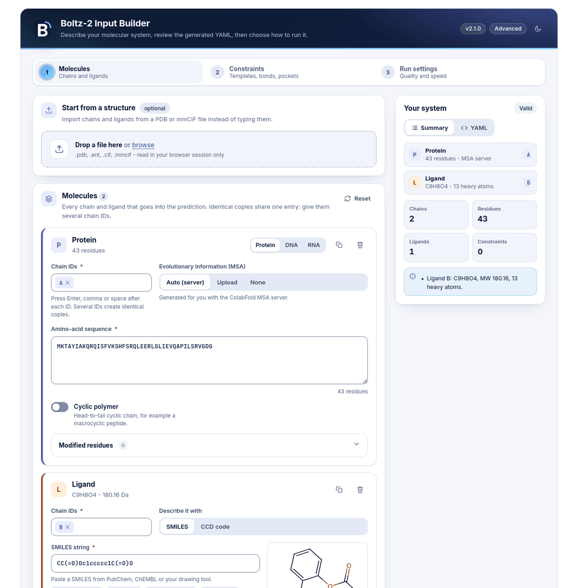
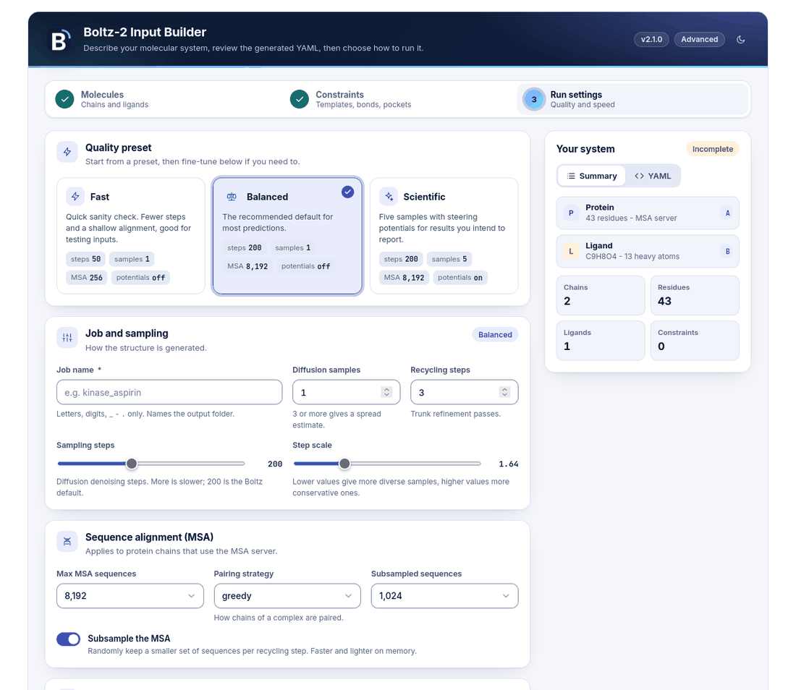
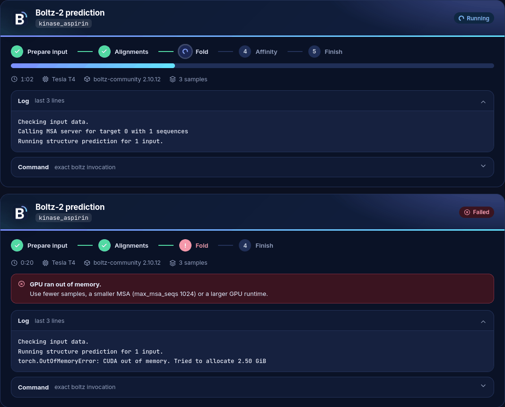
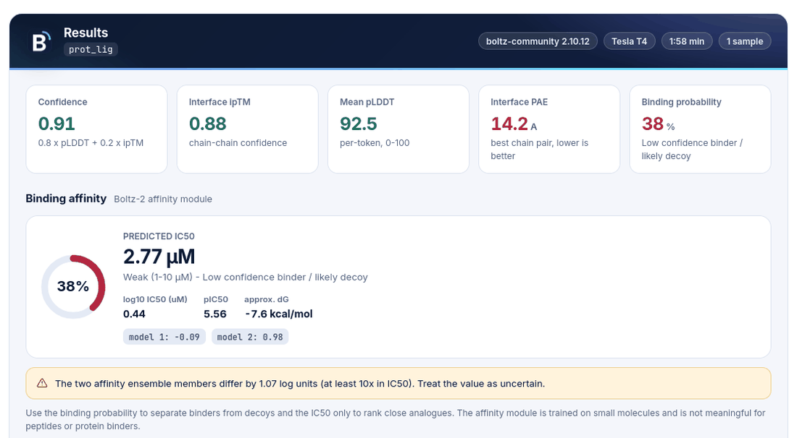

# Boltz2 Notebook - Advanced Biomolecular Structure Prediction & Affinity Analysis


**Interactive Google Colab front-ends for [Boltz-2](https://github.com/jwohlwend/boltz)** — protein, nucleic-acid and protein-ligand structure prediction with binding-affinity estimation, confidence analysis and reports. No local GPU installation required; the same code also runs on a workstation.


<div align="center">

[](https://doi.org/10.64898/2026.09.18.752645)

[](https://github.com/AtharvaTilewale/boltz2-notebook/actions/workflows/ci.yml)


</div>

---

## Quick Start

**Launch in Google Colab (Free GPU):**


> **Note:** Google Colab provides free GPU access (T4 GPU). For best performance, select GPU runtime: `Runtime → Change runtime type → GPU`


| Version | Features | Status | Launch |
|---------|----------|--------|------|
| **V2.0.0 (default)** | Multi-entity support, DNA/RNA, Advanced constraints, Cyclic peptides, PTMs |  | [](https://colab.research.google.com/github/AtharvaTilewale/boltz2-notebook/blob/main/Boltz2.ipynb) |
| **V1.0.0 (Standard)** | Multi-chain proteins, Protein-ligand binding, Affinity analysis |  | [](https://colab.research.google.com/github/AtharvaTilewale/boltz2-notebook/blob/main/colab/v1/Boltz2_v1.0.0.ipynb) |
| **Batch v1.0** | Batch processing, CSV/FASTA inputs, High-throughput screening |  | [](https://colab.research.google.com/github/AtharvaTilewale/boltz2-notebook/blob/main/batch/Boltz2_Batch_v1_beta.ipynb) |

---

## Key Features

- **Structure prediction** for single proteins, multi-chain complexes, DNA/RNA and small-molecule ligands (SMILES or CCD code)
- **Binding affinity** (Boltz-2 affinity module): binding probability plus predicted IC50 with correct units (log10 µM → nM/µM, pIC50)
- **Advanced inputs** — covalent bonds, pocket and contact conditioning, template guidance, PTMs, cyclic peptides, custom MSAs
- **Confidence analysis done right** — per-token pLDDT, the *asymmetric* PAE matrix on a fixed 0–32 Å scale with inter-chain blocks, per-chain and interface summaries
- **Ensemble statistics** across diffusion samples (mean ± SD of confidence, ipTM, pLDDT, affinity spread)
- **Standalone HTML report** per job with embedded figures, 3-D viewer, metrics tables and full provenance (`run_context.json`)
- **Live logs and diagnostics** — Boltz output streams into the cell; failures come with a likely cause and a fix
- **Batch mode** — CSV/FASTA/YAML manifests, resume, ranking, export
- **Reproducible** — pinned engine version, pinned notebook version (git tag), no silent overwrites
- **Private** — no account lookups, no hidden logging; usage reports are opt-in, encrypted for the maintainer and never contain sequences or ligands ([exactly what is sent](docs/PRIVACY.md))
- **Tested** — the logic lives in the `boltz2nb` package with a pytest suite and CI; generated inputs are validated with Boltz's own parser

---
<!-- ## Available Notebooks

| Notebook | Status | Features | Best For | Link |
|----------|--------|----------|----------|------|
| **V2.0.0 (default)** |  | Multi-entity support, Advanced constraints, Template guidance, Affinity prediction, Cyclic peptides, PTMs | Production & Research | [](https://colab.research.google.com/github/AtharvaTilewale/boltz2-notebook/blob/main/Boltz2.ipynb) |
| **V1.0.0 (Standard)** |  | Multi-chain protein prediction, Protein-ligand binding, Affinity analysis, 3D visualization | Standard predictions | [](https://colab.research.google.com/github/AtharvaTilewale/boltz2-notebook/blob/main/colab/v1/Boltz2_v1.0.0.ipynb) |
| **Batch v1.0.0** |  | Batch processing, CSV/FASTA inputs, High-throughput screening, Result ranking, Manifest validation | Large-scale screening | [](https://colab.research.google.com/github/AtharvaTilewale/boltz2-notebook/blob/main/batch/Boltz2_Batch_v1_beta.ipynb)  -->


## Feature Comparison

| Feature | V1.0.0 | V2.0.0 | Batch |
|---------|:------:|:------:|:-----:|
| Single protein prediction | ✅ | ✅ | ✅ |
| Protein-ligand binding | ✅ | ✅ | ✅ |
| Multi-chain complexes | ✅ | ✅ | ✅ |
| DNA/RNA support | ❌ | ✅ | ✅ (CSV columns) |
| Template guidance | ✅ | ✅ | ✅ |
| Custom MSA upload | ❌ | ✅ | ❌ |
| Post-translational modifications | ❌ | ✅ | ❌ |
| Custom constraints | ❌ | ✅ | ❌ |
| Covalent bonds | ❌ | ✅ | ❌ |
| Cyclic peptides | ❌ | ✅ | ❌ |
| Affinity prediction | ✅ | ✅ | ✅ |
| Batch processing | ❌ | ❌ | ✅ |
| CSV/FASTA input | ❌ | ❌ | ✅ |
| 3D visualization | ✅ | ✅ | ✅ |
| Ensemble statistics / HTML report | ✅ | ✅ | ✅ (summary CSV) |


### Notebook Selection Guide

- **Most users, and anything with DNA/RNA, templates or constraints?** → Use **V2.0.0**, the default notebook (stable; it also covers everything V1 does)
- **Only proteins and small-molecule ligands, and you want the shortest form?** → Use **V1.0.0** (Standard)
- **Large-scale screening?** → Use **Batch v1.0** (automated high-throughput)

---

## Available Notebooks

| Notebook | Status | Best For |
|----------|--------|----------|
| [V2.0.0 (default)](colab/v2/Boltz2_V2.0.0.ipynb) |  | Advanced modeling, multi-entity complexes, structure-guided design |
| [V1.0.0 (Standard)](colab/v1/Boltz2_v1.0.0.ipynb) |  | Production predictions, protein-ligand binding, standard analysis |
| [Batch v1.0](batch/Boltz2_Batch_v1_beta.ipynb) |  | High-throughput screening, batch processing, automation |
| [Parameter Generator](notebooks/Boltz2_paramgen.ipynb) | Utility | Custom configuration and input building |

---


<!-- ---

## Overview

**Boltz2-Notebook V2.0.0** is an advanced interactive Google Colab platform for:

- **Diffusion-based protein structure prediction**
- **Protein-ligand binding affinity estimation**
- **Multi-chain complex modeling** (proteins, DNA, RNA)
- **Structure-guided design** (templates, constraints)
- **Binding pocket prediction & contact conditioning**
- **Interactive 3D visualization** with confidence metrics
- **Automated analysis** (pLDDT, PAE, affinity scoring) -->

<!-- This notebook eliminates the need for local GPU setup or command-line configuration, providing a fully guided workflow from input to publication-ready results. -->

<!-- ---

## What's New in V2.0.0?

### Advanced Input Builder
- **Multi-entity support**: Proteins, DNA, RNA, and ligands in one prediction
- **Sequence modifications**: Post-translational modifications at specific residues
- **Cyclic polymers**: Support for circular protein chains
- **Custom MSA upload**: Provide pre-computed multiple sequence alignments
- **Template guidance**: Structure-based modeling with PDB/CIF templates

### Constraint System
- **Covalent bonds**: Define custom bonds between atoms
- **Pocket conditioning**: Specify binding pockets with distance constraints
- **Contact pairs**: Force proximity between specific residue pairs
- **Affinity properties**: Mark binder chains for affinity estimation

### Enhanced Analysis
- **Hit discovery dashboard**: Binding probability visualization
- **Affinity assessment**: Predicted binding strength scoring
- **Confidence metrics**: Per-residue confidence (pLDDT, PAE)
- **Color-coded results**: Interactive 3D structure visualization
- **Automated ranking**: Top predictions by quality metrics

### Performance Improvements
- **Configurable run profiles**: Fast, balanced, scientific quality modes
- **Potentials refinement**: Physics-based energy minimization (optional)
- **Multi-sample generation**: Generate multiple conformations per job
- **GPU acceleration**: Full CUDA support for speed optimization -->

---

## Interface

Every screen shares one design system: a three-step input builder, a live run panel, a result card and a self-contained report.
It is light by default, with a light / dark switch in the header of every panel (input builder, run panel, result card and the HTML report), and is laid out for screens from 360 px wide upwards.

| Input builder | Run settings |
|:--|:--|
|  |  |

| Live run panel | Result card |
|:--|:--|
|  |  |

Highlights: chain-ID chips, FASTA paste, PDB / mmCIF import, ligand preview, Fast / Balanced / Scientific presets, a live YAML preview,
validation messages next to the field that caused them, and failure messages that name the likely cause and the fix.

---

## Architecture & Workflow

The notebooks are thin shells. Cell 1 clones a **pinned tag** of this repository and installs the `boltz2nb`
package plus the Boltz engine (`boltz[cuda]==2.2.1` on Python ≤ 3.12, `boltz-community[cuda]==2.10.12` on 3.13);
the remaining cells `%run` three scripts that call into the package.

```
┌──────────────────────────────────────────────────────────────────────┐
│ Cell 1  setup.py          pinned engine + boltz2nb, GPU check         │
│ Cell 2  warm-up           weights/CCD download (~6 GB once per runtime)│
├──────────────────────────────────────────────────────────────────────┤
│ Cell 3  param_gen.py      boltz2nb.ui input builder → yaml_builder     │
│                           validates alphabets, chain IDs, constraints, │
│                           SMILES (RDKit) → params.yaml + run_params.txt│
├──────────────────────────────────────────────────────────────────────┤
│ Cell 4  Boltz_Run.py      boltz2nb.runner: builds `boltz predict …`,   │
│                           live run panel (phases, timer, log),         │
│                           result card; never overwrites a job folder   │
├──────────────────────────────────────────────────────────────────────┤
│ Cell 5  analysis.py       boltz2nb.analysis/report: token mapping,     │
│                           pLDDT, PAE, interface PAE, affinity, ensemble│
│                           → analysis/<job>_report.html + summary.json  │
└──────────────────────────────────────────────────────────────────────┘
```

Package layout: `boltz2nb/` (`yaml_builder`, `run_params`, `runner`, `tokens`, `analysis`, `report`, `batch`,
`diagnostics`, `msa_cache`, `ligand`, `pdb_import`, `telemetry`, `install`, and `ui/` with the interface assets and renderers),
`scripts/common/` (cell implementations), `scripts/v1|v2/` (thin launchers for the standard and advanced form), `tests/`.

**Typical Time:** 2-10 minutes on T4 GPU (depending on complexity)

---

<!-- ## Core Scripts Reference

### 1. `param_gen.py` - Parameter Generator

**Purpose:** Converts user input (proteins, ligands, constraints) into Boltz2 YAML configuration files.

**Key Functions:**

| Function | Purpose |
|----------|---------|
| `_build_sequences()` | Validates and formats protein/DNA/RNA/ligand sequences |
| `_save_params()` | Generates `params.yaml` with YAML structure |
| `_save_run_params()` | Creates `run_params.txt` with execution settings |
| `_save_uploaded_file()` | Handles template and MSA file uploads |
| `_clean_ids()` | Sanitizes chain IDs and entity identifiers |
| `_clean_sequence()` | Normalizes protein sequences to uppercase |

**Input Data Structure:**
```python
{
    "sequences": [
        {
            "type": "protein",
            "data": {
                "id": ["A"],
                "sequence": "MKTAYIAKQRQ...",
                "msa": "/path/to/custom.a3m",  # optional
                "modifications": [
                    {"position": 5, "ccd": "PTR"},  # phosphotyrosine at pos 5
                    {"position": 10, "ccd": "HYP"}   # hydroxyproline at pos 10
                ],
                "cyclic": True  # circular protein chain
            }
        },
        {
            "type": "ligand",
            "data": {
                "id": ["B"],
                "smiles": "CC(=O)Oc1ccccc1C(=O)O"  # Aspirin
                # OR "ccd": "HEM"  # Heme (use one, not both)
            }
        }
    ],
    "constraints": {
        "bonds": [
            {
                "chain1": "A", "res1": 50, "atom1": "SG",
                "chain2": "B", "res2": 10, "atom2": "S"  # covalent bond
            }
        ],
        "pockets": [
            {
                "binder": "A",
                "contacts": [
                    {"chain": "B", "ref": "10"},  # residue 10 in chain B
                    {"chain": "B", "ref": "ARG"}  # by name (if unique)
                ],
                "max_distance": 8.0,  # Å
                "force": False
            }
        ],
        "contacts": [
            {
                "chain1": "A", "ref1": 50,
                "chain2": "B", "ref2": 20,
                "max_distance": 5.0,
                "force": True
            }
        ]
    },
    "templates": [
        {
            "path": "/path/to/template.pdb",
            "chain_id": ["A"],
            "template_id": ["template1"],
            "force": False,
            "threshold": 0.5  # confidence cutoff
        }
    ],
    "properties": {
        "affinity_binder": "B"  # chain to compute affinity for
    }
}
```

**Output Files:**
- `params.yaml` - Boltz2 configuration file
- `run_params.txt` - Execution parameters

---

### 2. `Boltz_Run.py` - Execution Engine

**Purpose:** Runs the Boltz2 prediction pipeline with loaded parameters and generates 3D structures.

**Key Functions:**

| Function | Purpose |
|----------|---------|
| `loader()` | Displays animated CLI loading spinner |
| `parse_value()` | Converts string parameters to Python types |
| `clean_ansi_codes()` | Removes terminal color codes from output |
| `create_visualizations()` | Extracts PDB data for 3D visualization | -->

### Execution Pipeline

1. `run_params.txt` is parsed and validated (ranges, names, pairing strategy).
2. `params.yaml` is re-serialised through the builder (no shell/`sed` step) to `<job>.yaml`.
3. Output goes to `/content/boltz_data/<job>/`; an existing folder is kept and a timestamped sibling is used unless *override* is ticked.
4. The command is built once, in `boltz2nb.runner.build_boltz_cmd` (shared with batch mode):
   ```bash
   boltz predict <job>.yaml --out_dir <job> --recycling_steps 3 --sampling_steps 200 \
     --diffusion_samples 1 --step_scale 1.638 --max_msa_seqs 8192 --output_format pdb \
     --use_msa_server --msa_pairing_strategy greedy --subsample_msa --num_subsampled_msa 1024 \
     --max_parallel_samples 5 --write_full_pae [--use_potentials] [--override] [--seed N]
   ```
   `--use_msa_server` is omitted when every protein chain carries an `msa:` entry (uploaded MSA, cache hit, or `empty`).
5. `boltz.log`, `run_context.json` (engine/torch/CUDA versions, GPU, command, input YAML + SHA-1) and `status.json` are written next to the predictions.

### Configuration Parameters

| Parameter | Default | Range | Meaning |
|-----------|---------|-------|---------|
| `recycling_steps` | 3 | 1–20 | Trunk recycling iterations |
| `sampling_steps` | 200 | 10–1000 | Diffusion denoising steps |
| `diffusion_samples` | 1 | 1–25 | Structures per job (≥3 recommended to get a spread estimate) |
| `step_scale` | 1.638 | 0.5–5 | Diffusion temperature-like scale |
| `max_msa_seqs` | 8192 | 1–16384 | MSA depth cap |
| `subsample_msa` / `num_subsampled_msa` | on / 1024 | — | MSA subsampling |
| `msa_pairing_strategy` | greedy | greedy / complete | Pairing for multi-chain server MSAs |
| `use_potentials` | off | — | Physics-based steering potentials |
| `override` | off | — | Reuse/overwrite the job folder |

### Reading the results

| Quantity | File | Meaning |
|---|---|---|
| pLDDT | `plddt_<job>_model_k.npz` | Per-token confidence, 0–100 (≥90 very high, 70–90 high, 50–70 low, <50 very low). One token per residue; one per heavy atom for ligands and modified residues. |
| PAE | `pae_<job>_model_k.npz` | Token × token expected position error in Å. **Asymmetric**: row = aligned token, column = scored token. Off-diagonal chain blocks measure interface confidence. |
| `confidence_score`, `ptm`, `iptm`, `ligand_iptm`, `complex_plddt`, `complex_pde` | `confidence_<job>_model_k.json` | Boltz ranking metrics (model 0 is the top-ranked sample). |
| `affinity_probability_binary` | `affinity_<job>.json` | Probability that the ligand is a binder (hit discovery). |
| `affinity_pred_value` | `affinity_<job>*.json` | **log10(IC50) in µM** — not kcal/mol. `-2` ≈ 10 nM, `0` = 1 µM, `1` = 10 µM. The report also gives pIC50 (= 6 − value) and an approximate ΔG. Only meaningful for small-molecule ligands. |

## Troubleshooting

Every failed run prints a *likely cause* and a *suggested fix* derived from the log (`boltz2nb/diagnostics.py`). Common cases:

| Issue | Cause | Solution |
|-------|-------|----------|
| **CUDA out of memory** | Complex too large for the GPU | `max_msa_seqs 256`, `diffusion_samples 1`, `max_parallel_samples 1`; use an L4/A100 runtime |
| **MSA generation failed / timed out** | ColabFold server unavailable | Retry later, upload an `.a3m`, or tick single-sequence mode |
| **Invalid SMILES** | Malformed ligand string | The parameter step validates SMILES with RDKit and shows formula/MW |
| **Affinity requested for a protein chain** | Boltz-2 affinity only supports small molecules | Untick affinity for protein–protein jobs |
| **Python 3.13 runtime** | Official `boltz` wheels need < 3.13 | Handled automatically (community fork); or choose runtime version 2026.7 |
| **Low pLDDT everywhere** | Novel/disordered region or single-sequence mode | Provide an MSA; try template guidance |

## Diagnosing an output mismatch

Engine versions differ in how the confidence arrays line up with the written structure. The analysis
step detects the convention; if it cannot, it still reports the ranking metrics and affinity and says
so. To see exactly what was found:

```bash
python -m boltz2nb.doctor /content/boltz_data/<job>
```

## Running outside Colab

```bash
git clone https://github.com/AtharvaTilewale/boltz2-notebook && cd boltz2-notebook
pip install -e ".[ligand,viewer]" "boltz[cuda]==2.2.1"
export BOLTZ2NB_BASE_DIR=$PWD/boltz_data      # where params.yaml / run_params.txt / results live
python - <<'PY'
from boltz2nb.yaml_builder import build_yaml, write_yaml, simple_spec
from boltz2nb.run_params import serialize_run_params, DEFAULTS
write_yaml(build_yaml(simple_spec("MKTAYIAKQRQISFVKSHFSRQLEERLGL", ligand_smiles="CC(=O)Oc1ccccc1C(=O)O", affinity=True)), "boltz_data/params.yaml")
open("boltz_data/run_params.txt", "w").write(serialize_run_params(dict(DEFAULTS, job_name="demo")))
PY
python scripts/common/Boltz_Run.py && python scripts/common/analysis.py   # report in boltz_data/demo/analysis/
pytest                                                                   # unit tests, no GPU required
```

---

<!-- ## File Structure

```
V2.0.0/
├── Boltz2_V2.0.0.ipynb           # Main notebook
├── README.md                       # This file
├── scripts/
│   ├── param_gen.py               # Input builder → params.yaml
│   ├── Boltz_Run.py               # Boltz2 executor
│   ├── analysis.py                # Results analyzer & visualizer
│   ├── setup.py                   # Environment setup
│   ├── dist/                      # Distribution files
│   └── __pycache__/               # Python cache
└── New Features.txt               # V2 changelog
``` -->
<!-- 
---

## Requirements

- **Python:** 3.8+
- **GPU:** NVIDIA GPU (T4 or better recommended)
- **Runtime:** Google Colab (free) or Linux with CUDA
- **Dependencies:** PyTorch, Biopython, NumPy, Matplotlib, PyYAML, py3Dmol

--- -->

## Documentation

- **[Version Table](releases/version_table.md)** — Feature comparison across releases
- **[Changelog](releases/CHANGELOG.md)** — Complete release history
- **[Batch README](batch/README.md)** — High-throughput batch processing guide
- **[Usage reports for maintainers](docs/TELEMETRY.md)** — How to receive and read the opt-in, encrypted usage reports
- **[Privacy](docs/PRIVACY.md)** — What leaves the runtime (the MSA request, the CCD-code lookup, and - only if you tick `SEND_USAGE_STATS` - the encrypted usage reports)
- **[Contributing](CONTRIBUTING.md)** — Package layout, tests, release process
- **[Verification log](docs/VERIFICATION.md)** — What has been tested, how, and what has not

---

## Citation

If you use Boltz2-Notebook, please cite:

```bibtex
@article{Tilewale2026.09.18.752645,
  author = {Tilewale, Atharva and Patel, Dhaval},
  title = {Boltz2-Notebook: An Interactive Google Colab Platform for Diffusion-Based Biomolecular Structure and Binding Affinity Prediction using the Boltz2 model.},
  elocation-id = {2026.09.18.752645},
  year = {2026},
  doi = {10.64898/2026.09.18.752645},
  publisher = {Cold Spring Harbor Laboratory},
  URL = {https://www.biorxiv.org/content/early/2026/09/24/2026.09.18.752645},
  eprint = {https://www.biorxiv.org/content/early/2026/09/24/2026.09.18.752645.full.pdf},
  journal = {bioRxiv}
}

@article{Passaro2025,
  title={Boltz-2: Towards Accurate and Efficient Binding Affinity Prediction},
  author={Passaro, S. and Corso, G. and Wohlwend, J. and others},
  journal={bioRxiv},
  year={2025}
}

@article{Wohlwend2024,
  title={Boltz-1: Democratizing Biomolecular Interaction Modeling},
  author={Wohlwend, J. and Corso, G. and Passaro, S. and others},
  journal={bioRxiv},
  year={2024}
}
```

---

## Credits & Links

- **Notebook:** [Atharva Tilewale](https://github.com/AtharvaTilewale) & Dr. Dhaval Patel (Gujarat Biotechnology University)
- **Boltz-2 engine:** [jwohlwend/boltz](https://github.com/jwohlwend/boltz) (`boltz==2.2.1`); on Python 3.13 runtimes the [boltz-community](https://github.com/Novel-Therapeutics/boltz-community) fork (`2.10.12`) is installed instead
- **License:** MIT License — See [LICENSE](LICENSE) for details.

---

## Getting Help

- **Issues & Bugs:** [GitHub Issues](https://github.com/AtharvaTilewale/boltz2-notebook/issues)
- **Feature Requests:** [GitHub Discussions](https://github.com/AtharvaTilewale/boltz2-notebook/discussions)
- **Questions:** See the [Q&A Documentation](docs/) or open a discussion

---

**Version:** 2.1.1 | **Changelog:** [releases/CHANGELOG.md](releases/CHANGELOG.md)